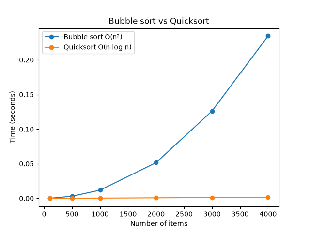

# Bubble Sort vs Quicksort

A Python project that implements bubble sort and compares it with quicksort by timing both on lists of different sizes.

## Files
- `bubble_sort.py` – bubble sort
- `quick_sort.py` – quicksort
- `benchmark.py` – times both algorithms and draws the graph
- `performance_graph.png` – the graph of the results
- `report.md` – my report

## How to run
    pip install matplotlib
    python3 benchmark.py

